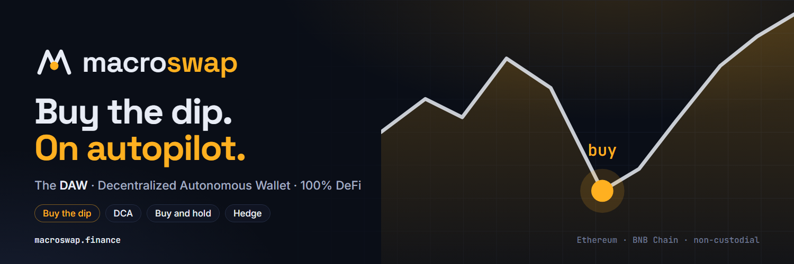

# MacroSwap

Non-custodial orders that buy a Bitcoin-led basket when Bitcoin falls below a reference you choose. The tokens stay in your wallet until each buy. You can also send stablecoin to your own deposit address and buy right away, or sell the basket back to stablecoin now or at a target price.

Not a promise of returns. Prices can fall and you can lose money.

This repository is the public record of the project: the contract sources in [`contracts/`](contracts/) and the logos in [`assets/`](assets/). The app is at **https://macroswap.finance**.

The mark is an "M" drawn as a chart: two peaks, the dip in the middle, and an amber dot on the buy.

## How a purchase works

You set the rules in a transaction. Anyone can send the transaction that carries them out, but only after the contract checks pass. Bought tokens go to your wallet in the same transaction. The contracts are not upgradeable. A change to a parameter waits 24 hours, and the fees cannot be changed at all.

1. You approve a stablecoin and create an order: how much you can spend, how much each buy uses, how far Bitcoin must fall, and how long the order may wait.
2. The stablecoin stays in your wallet. Cancelling the order, or revoking the approval, stops further buys.
3. Bitcoin has to be below the high you chose (30-day, 1-year, or all-time) by at least the drop you set, and below your reference. The reference starts as the price at creation and then follows your average buy price.
4. The fee goes to the treasury, the tip goes to whoever sent the transaction, and the basket goes to you.

A deposit address is separate from the dip order. Stablecoin sent there is bought on the next execution, with no dip check. What has not been bought yet can be withdrawn to the owner of that address. The address is different on each network: a transfer on the wrong network does not arrive.

A sale sells the basket back to the network's main stablecoin. Each swap is checked against the Chainlink price. A target sale waits until Bitcoin reaches a price you set, then sells the share you chose.

| Mode | When it runs | Fee |
|---|---|---|
| Dip order | Bitcoin is below your reference and your chosen high | 0.25% |
| Deposit | Stablecoin arrives at your deposit address | 0.50% |
| Sell now | You send the transaction | 0.50% |
| Target sale | Bitcoin reaches the price you set | 0.25% |

The basket is fixed per network. The default split is 75% Bitcoin, 20% large assets, and 5% smaller assets. A wallet can change its own split inside those limits. A buy of up to $100 goes entirely to Bitcoin.

| | Ethereum | BNB Chain |
|---|---|---|
| DEX | Uniswap V3 | PancakeSwap V3 |
| Stablecoin used first | USDC, then USDT | USDT, then USDC |
| Bitcoin | WBTC | BTCB |
| Larger assets | WETH, SOL, BNB | ETH, SOL, WBNB |
| Smaller assets | AAVE, LINK, UNI | AAVE, LINK, UNI, XRP, DOGE, LTC |
| Minimum buy | $100 | $10 |

The second stablecoin is converted in a 0.01% pool and the buy reverts if the conversion returns less than 99.5% of face value. Sales pay the main stablecoin.

## Contracts

Solidity 0.8.26, optimizer on (200 runs), EVM version Paris. License: MIT, in the file headers. The verified code on the explorers is the reference for what is deployed. The same addresses are on Ethereum and BNB Chain.

| File | What it does | Address |
|---|---|---|
| [`MacroSwap.sol`](contracts/MacroSwap.sol) | Dip orders, the personal deposit address, and the basket split. The deposit-box code is in this file. | [`0xB60e34a0edB0f73E83A8704E56141e12618184C1`](https://etherscan.io/address/0xB60e34a0edB0f73E83A8704E56141e12618184C1) |
| [`MacroSwapSell.sol`](contracts/MacroSwapSell.sol) | Sell now and sell at a target price | [`0x5f9709738a2A436f6F736d73f7d7dFf1D72cc8C3`](https://etherscan.io/address/0x5f9709738a2A436f6F736d73f7d7dFf1D72cc8C3) |
| [`MacroSwapTracker.sol`](contracts/MacroSwapTracker.sol) | Non-transferable NFT (`MSTRACK`) with a wallet's buys, average price, and settings | [`0xa37b3fF7A1cABf77256a4B246eBa1652011e4569`](https://etherscan.io/address/0xa37b3fF7A1cABf77256a4B246eBa1652011e4569) |

On BscScan the addresses are the same, for example [MacroSwap](https://bscscan.com/address/0xB60e34a0edB0f73E83A8704E56141e12618184C1).

The deposit-box implementation, `0x1bB44C20E6036a4Cd916cA718986b8E024efEd96`, is not a deposit address. Sending tokens to it does not credit a wallet. Each wallet has its own deposit address, shown in the app.

| Role | Address |
|---|---|
| Owner (Safe, 2 of 2) | `0xb9D326a805C2B2eC5D129AFEf1990e71B213b938` |
| Treasury (Safe, 2 of 2) | `0x1A07b1C15d9CE167b24aF15CC5A5a197Bb748599` |

The owner cannot take tokens out of a wallet, change the fees, or upgrade the contracts. The treasury receives the fees.

The Tracker NFT cannot be sold or transferred. It has no value, rights, or rewards. Burning it does not change orders or balances. If the API is offline, the contract can still draw the image.

## The rest of the system

The website reads the networks in the browser. It does not hold keys or funds. Every buy, sale, approval, and cancellation asks for your signature. Anyone can send the transaction that executes an order, and receives only the tip you set.

Solana is not deployed. The only Solana address is the donation address `5S9GTgCLSujTxLZ67eKxqRZvosr6mnxAdFPaJstnGUxs`. A donation is a gift: no token and no reward.

There is no MacroSwap token. There is no official browser wallet in a store. A self-custody wallet for Ethereum, BNB Chain, and Solana is in development and is not published. Anything sold as a MacroSwap token or wallet is not this project.

## Links

| | |
|---|---|
| App | https://macroswap.finance/app |
| Tracker | https://macroswap.finance/app/tracker |
| Use it without the site | https://macroswap.finance/no-site/ |
| Terms of use | https://macroswap.finance/terms/ |
| Privacy policy | https://macroswap.finance/privacy/ |
| Whitepaper | https://macroswap.finance/whitepaper/ |
| API | https://api.macroswap.dev |
| NFT data | https://nft.macroswap.dev |

## Assets

Logos and icons. Usage rules are below. These files are not part of the MIT license of the contracts.

### Logo (mark + wordmark)

| File | Size | Background |
|---|---|---|
| [`macroswap-logo-2400.png`](assets/macroswap-logo-2400.png) · [`macroswap-logo-1200.png`](assets/macroswap-logo-1200.png) | 2400×600 · 1200×300, transparent | dark |
| [`macroswap-logo-light-2400.png`](assets/macroswap-logo-light-2400.png) · [`macroswap-logo-light-1200.png`](assets/macroswap-logo-light-1200.png) | 2400×600 · 1200×300, transparent | light |

### Icon and mark

| File | Use | Background |
|---|---|---|
| [`macroswap-icon.svg`](assets/macroswap-icon.svg) | app icon, avatars, listings, block explorers (vector, any size) | any (it has its own dark circle) |
| [`macroswap-icon-32.svg`](assets/macroswap-icon-32.svg) | the same icon declared as 32×32, for forms that check the SVG size | any |
| [`macroswap-icon-32.png`](assets/macroswap-icon-32.png) | logo on Etherscan / BscScan, for the Tracker NFT (32×32) | any |
| [`macroswap-icon-256.png`](assets/macroswap-icon-256.png) | listings and wallet directories (256×256) | any |
| [`macroswap-icon-512.png`](assets/macroswap-icon-512.png) | social profiles (512×512) | any |
| [`macroswap-mark.svg`](assets/macroswap-mark.svg) | the mark alone, transparent | dark |
| [`macroswap-mark-light.svg`](assets/macroswap-mark-light.svg) | the mark alone, transparent | light |

The icon PNGs are rendered from `macroswap-icon.svg`. The background outside the circle is transparent.

### Banners

| File | Size | Use |
|---|---|---|
| [`macroswap-banner-1500x500.png`](assets/macroswap-banner-1500x500.png) | 1500×500 | X header |
| [`macroswap-banner-1200x630.png`](assets/macroswap-banner-1200x630.png) | 1200×630 | link previews |
| [`macroswap-banner-1280x640.png`](assets/macroswap-banner-1280x640.png) | 1280×640 | GitHub social preview. Upload it in the repository settings. |

[`assets/source/banner.html`](assets/source/banner.html) and [`assets/source/logo.html`](assets/source/logo.html) are the templates the PNGs were rendered from (Space Grotesk, Inter, JetBrains Mono). Open one with `?w=<width>&h=<height>` (and `&t=light` for the light logo) and screenshot at that size.

## Colors

Dark theme:

| Name | Hex | Use |
|---|---|---|
| Ink | `#0A0E17` | background; also the mark on light backgrounds |
| Surface | `#111726` | cards |
| Mist | `#E8ECF5` | text and the mark on dark backgrounds |
| Amber | `#FFB020` | the dip dot, buys, main actions |
| Blue | `#7C9CFF` | information |
| Green | `#34D399` | success |
| Red | `#F87171` | errors |

Light theme: background `#F6F7FB`, cards `#FFFFFF`, text `#0A0E17`, amber `#E09400`, blue `#4A6CF0`, green `#0E9F6E`, red `#DC2626`.

## Typography

- Headings and wordmark: **Space Grotesk** 600. The wordmark is **macro**swap, with "swap" in amber.
- Body: **Inter** 400/500.
- Numbers and addresses: **JetBrains Mono**.

All three are free on Google Fonts.

## Using the logo

Do:

- Keep clear space around the mark at least the height of the amber dot.
- Use the light mark on light backgrounds and the regular mark on dark ones. The round icon works on both.
- Link to https://macroswap.finance.

Don't:

- Recolor, stretch, rotate, add effects, or rebuild the mark.
- Use the logo to suggest a partnership, an endorsement, or a product that is not official.
- Put it on a site, app, or token that imitates MacroSwap.
